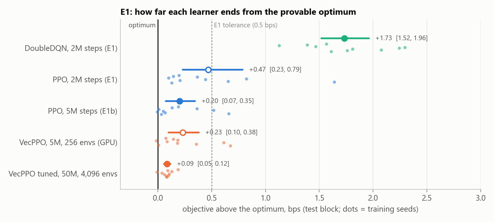
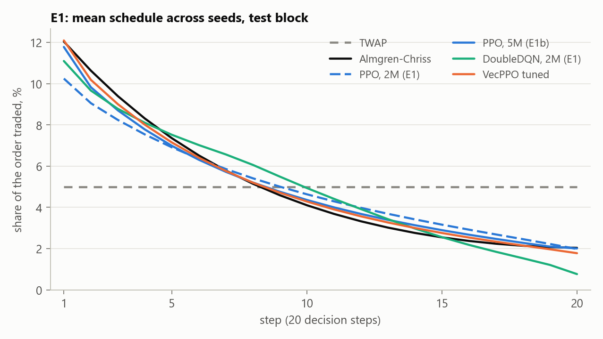
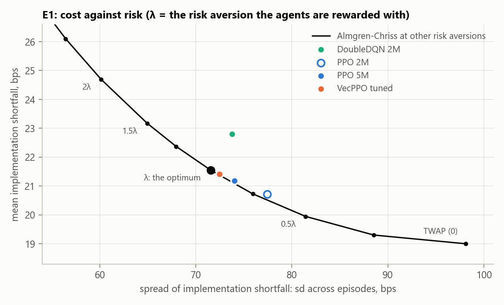
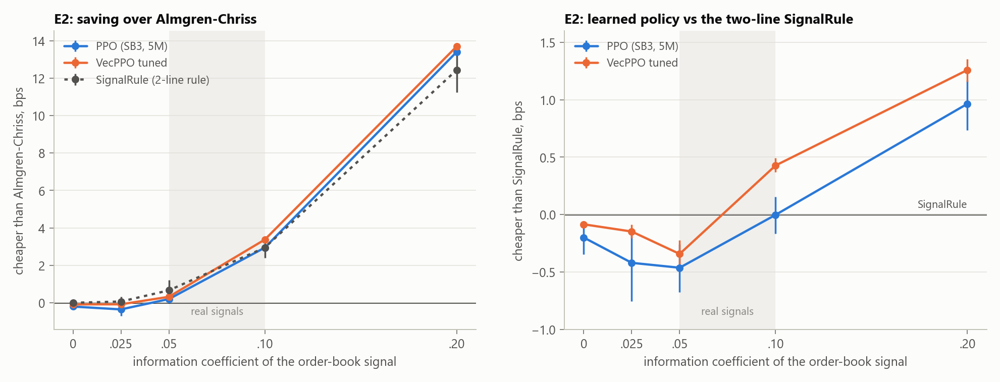
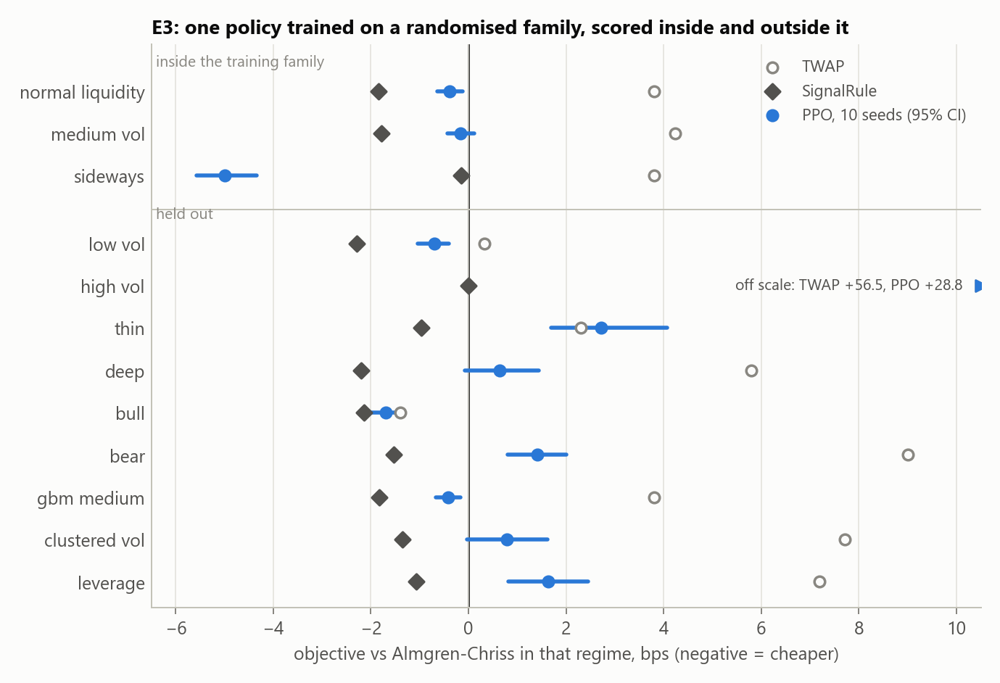
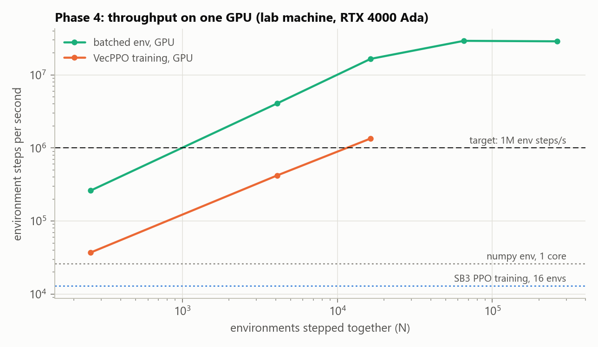

# Results

Can a reinforcement-learning agent learn to execute a large order as well as the
closed-form optimum, use a realistic short-horizon signal better than a simple rule, and
hold up on markets it was not trained on? This page answers those three questions on the
recalibrated simulator, with every number traceable to a committed run folder and
re-checkable with one command ([Reproducing](#reproducing-these-numbers)).

**In short**

- **E1, ground truth.** With no signal, PPO gets within **0.1–0.2 bps** of the provably
  optimal Almgren-Chriss schedule on an objective of 28.9 bps. The pre-registered PPO run
  (2M steps) is 0.47 bps off, inside the 0.5 bps tolerance but with a schedule flatter than
  optimal. After a tuning study on the GPU, PPO ends **+0.09 bps** (95% CI 0.05–0.12) from the
  optimum. DoubleDQN stays 1.7 bps off and fails the cost criterion.
- **E2, signal.** The saving over Almgren-Chriss grows with the signal's strength, but **at
  realistic strength (IC 0.025–0.05) the learned policy does not beat a two-line rule that
  uses the same signal**: it is 0.15–0.46 bps worse. The tuned policy pulls ahead from IC
  0.10, the strong end of real order-book signals; the untuned one only at 0.20.
- **E3, robustness.** One policy trained on a randomised family of markets loses **5.5 bps**
  against the optimum out of distribution (95% CI 5.0–6.0). Most of it comes from two
  regimes: at twice the training volatility it keeps its usual pace while the optimum speeds
  up, and in a mean-reverting market inside the family it beats the optimum by 5 bps.
  Without those two, the loss is 0.8 bps against 0.3 for TWAP.
- **Phase 4, GPU.** A batched PyTorch copy of the environment runs **~29M env steps/s** on one
  GPU and reproduces the reference simulator to 1e-12 in float64. PPO trained on it matches
  Stable-Baselines3 at the same budget (+0.23 vs +0.20 bps). It is fast enough that a
  four-config tuning study, 40 runs of 5M–200M steps, took under three hours.

Results marked *pre-registered* were judged against criteria written down before the run
([ROADMAP.md](ROADMAP.md), Phase 3). Everything else is *exploratory*, reported next to them
and never in their place.

---

## Setup

- **Task.** Sell 10,000 shares over 20 decision steps (~20 minutes each) through a simulated
  limit order book with a 10-level depth ladder, book-walk slippage, temporary and permanent
  impact and a 1 bp commission. Calibrated so that dumping at arrival costs ~158 bps, TWAP
  ~19 bps with ~104 bps of price risk, and the order-book imbalance predicts the next return
  with an information coefficient (IC) of ~0.075 (`scripts/calibrate.py`, pinned by tests).
- **Objective.** `J = implementation shortfall + λ·Σ(σ·x_t)²` in bps, the Almgren-Chriss
  mean-variance objective. Mark-to-market rewards sum to exactly `−0.01·J`, and the
  Almgren-Chriss baseline uses the same λ. On the E1 market (arithmetic Brownian motion,
  constant volatility, linear impact, no signal) its schedule is therefore **the optimum of
  the reward**, and "did the agent solve the problem" can be measured directly.
- **Action.** A multiplier on the TWAP pace, `a ∈ [−1, 1]`: −1 waits, 0 is TWAP, +1 sells
  everything now. An untrained policy starts at TWAP, not at a degenerate corner.
- **Agents.** PPO (Stable-Baselines3, 16 environments), DoubleDQN (own PyTorch, dueling
  head, 10 trade sizes) and VecPPO (own PPO on the batched GPU environment). Baselines: TWAP,
  VWAP, Almgren-Chriss, and three nulls an agent must beat to mean anything: dump at
  arrival, wait then dump, and `SignalRule` (the Almgren-Chriss pace tilted by the book
  signal, with one coefficient fitted on validation episodes).
- **Evaluation.** Three disjoint seed blocks: training, validation (checkpoint selection
  only, from seed 1,000,000) and test (5,000 antithetic episodes from seed 2,000,000, used
  only for the numbers below). All strategies face identical market paths, so every gap is a
  paired difference. Each configuration is trained on **10 seeds**, and the seed is the unit
  of analysis: CIs are 95% bootstrap intervals across seeds, and p-values are Holm-adjusted
  across each report's rows. A seed that trades in fewer than 5 effective steps would be
  flagged as degenerate; none was.

Columns: `J` objective; `IS` implementation shortfall (mean, sd across episodes, mean of the
worst 5%); effective steps (inverse Herfindahl of the schedule: 20 = TWAP, 1 = block trade);
`L1 to AC` distance of the mean schedule from Almgren-Chriss's (median seed; 0 = same shape,
2 = disjoint). All in bps except steps and L1.

---

## E1: does the learner recover the optimum?

| configuration | label | seeds | J | IS mean | IS sd | IS CVaR95 | eff. steps | L1 to AC | gap to AC [95% CI] | Holm p | degenerate |
|---|---|---|---|---|---|---|---|---|---|---|---|
| Almgren-Chriss (the optimum) | baseline | — | 28.87 | 21.55 | 71.6 | 168.4 | 14.7 | 0.000 | 0 (reference) | — | — |
| TWAP | baseline | — | 32.83 | 19.00 | 98.1 | 220.0 | 20.0 | 0.503 | +3.96 | < 0.001 | — |
| PPO (SB3), 2M steps | **E1, pre-registered** | 10 | 29.34 | 20.72 | 77.4 | 183.7 | 16.2 | 0.125 | +0.47 [0.23, 0.79] | 0.025 | 0 |
| DoubleDQN, 2M steps | **E1, pre-registered** | 10 | 30.60 | 22.80 | 73.8 | 176.4 | 13.5 | 0.197 | +1.73 [1.52, 1.96] | < 0.001 | 0 |
| PPO (SB3), 5M steps | E1b, exploratory | 10 | 29.07 | 21.18 | 74.0 | 177.5 | 15.3 | 0.065 | +0.20 [0.07, 0.35] | 0.048 | 0 |
| PPO (SB3), 2M steps on the 5M learning-rate schedule | E1b ablation, seeds 0–3 | 4 | 29.33 | 20.92 | 76.3 | 184.8 | 15.8 | 0.093 | +0.46 [0.07, 1.04] | 0.42 | 0 |
| VecPPO, 5M steps, 256 envs, GPU | **Phase 4 parity, pre-registered** | 10 | 29.10 | 21.20 | 74.0 | 178.0 | 15.3 | 0.074 | +0.23 [0.10, 0.38] | 0.030 | 0 |
| VecPPO tuned: 50M steps, 4,096 envs, GPU | tuning study winner, exploratory | 10 | 28.96 | 21.40 | 72.5 | 173.2 | 15.0 | 0.039 | +0.09 [0.05, 0.12] | 0.0012 | 0 |

<picture>
  <source media="(prefers-color-scheme: dark)" srcset="docs/figures/e1_gap_to_optimum-dark.png">
  
</picture>

**Verdict against the pre-registered criteria** (mean J within max(0.5 bps, its CI) of the
optimum; median-seed L1 below 0.10; no degenerate seed):

- **PPO at 2M steps: cost passes, schedule partial.** +0.47 bps is inside the tolerance, but
  measurably worse than optimal, and the median L1 of 0.125 falls in the band the criteria
  call *directionally right, under-tuned*. Its schedule front-loads like the optimum, only
  less (first trade 10% of the order against 12%). Four of ten seeds clear 0.10, and they are
  the cheapest ones.
- **DoubleDQN: fails on cost** (+1.73 bps, L1 0.197). Its greedy action reacts to noise in
  the observation, so its trade sizes vary from episode to episode where nothing is
  predictable. Uneven trades cost more under impact that grows faster than the trade size,
  and its mean schedule also dumps less at the end than the optimum does.
- **VecPPO parity: passes** all three conditions fixed before the GPU run (gap within ±0.30
  bps of SB3's +0.20, median L1 below 0.10, no degenerate seed). Seed numbers don't
  correspond across the two implementations, so the two are compared as distributions:
  mean difference +0.03 bps against a seed-level sd of 0.41.

**What closed the gap.** More steps help: every one of the ten PPO seeds improves from 2M
to 5M, the worst ones most. On seeds 0–3, a 2M run that follows the 5M learning-rate schedule
recovers only 42% of that gain, so it is the extra training, not the slower decay. At 5M, in
both implementations, what is left comes from three of ten seeds that stall at +0.36 to +0.67
bps, while the other seven are within 0.19. The GPU made the next lever cheap to test:
bigger batches.

<picture>
  <source media="(prefers-color-scheme: dark)" srcset="docs/figures/e1_schedule-dark.png">
  
</picture>

### Tuning study (exploratory)

Four VecPPO configurations, 10 seeds each, chosen by a rule fixed before any result: no
degenerate seed, then the lowest mean gap to the optimum on a **tuning block** (2,000
antithetic episodes from seed 1,500,000: inside the validation range but disjoint from the
episodes checkpoint selection used, and never the test block), with a cheaper config
preferred if it is within 0.05 bps of the best. Only the winner was then scored on the test
block, once ([results/tuning/TUNING.md](results/tuning/TUNING.md)).

| config | envs per rollout | steps | minibatch | train time per seed (lab GPU) | gap to AC on the tuning block [95% CI] | L1 to AC | degenerate |
|---|---|---|---|---|---|---|---|
| A (= the parity run) | 256 | 5M | 1,024 | 122 s | +0.106 [−0.011, 0.254] | 0.074 | 0 |
| **C** | 4,096 | 50M | 8,192 | 137 s | **−0.012 [−0.064, 0.043]** | 0.039 | 0 |
| D | 16,384 | 200M | 32,768 | 199 s | +0.016 [−0.031, 0.068] | 0.037 | 0 |
| B | 256 | 20M | 1,024 | 473 s | +0.224 [0.086, 0.372] | 0.091 | 0 |

- **C wins.** It takes about as many gradient steps as A, each on 8× more data. On the test
  block it ends at +0.09 bps [0.05, 0.12], and all ten seeds sit between −0.01 and +0.19 bps:
  the stalled seeds are gone. Its tuning-block estimate
  (−0.01) was optimistic, as expected for the selected config and because the across-seed CI
  ignores which 2,000 episodes were drawn.
- **More steps at the same batch size (B) did not help** (+0.22 on the tuning block). Its
  runs kept checkpoints from early on (5.3M of 20M steps on average) and then drifted 0.43
  bps above them on validation, as A's do (0.34 bps). C's validation curves end on average 0.04 bps
  above their best. The noise in each update, not the step budget, was the bottleneck.
- Re-training E2's no-signal point with C reproduced E1's C runs **bit for bit** (all ten
  weight files), so training on the GPU is deterministic per seed.

<picture>
  <source media="(prefers-color-scheme: dark)" srcset="docs/figures/e1_frontier-dark.png">
  
</picture>

The same results in cost–risk space: Almgren-Chriss traced over its risk aversion, on the
same test episodes. The PPO runs sit on or just beside the frontier, at a slightly lower
effective risk aversion than the reward asks for (PPO at 2M near 0.75λ): they trade cost
against risk almost efficiently and are a little too patient. DoubleDQN sits above the
frontier, paying more for the same risk, which is the cost of its uneven trades.

---

## E2: what is a realistic signal worth to a learned policy?

The E1 market with its order-book signal switched on at five strengths, everything else
unchanged; 10 seeds per strength, each trained and tested at that strength. The table shows
how much cheaper each strategy is than a benchmark (positive = better), in bps, with 95% CIs
across seeds. `SignalRule` is fitted on validation episodes and has one row per strength.

| IC | SignalRule vs AC | PPO vs AC | PPO vs SignalRule | VecPPO tuned vs AC | VecPPO tuned vs SignalRule |
|---|---|---|---|---|---|
| 0 | 0 (tie) | −0.20 [−0.35, −0.07] | −0.20 [−0.35, −0.07] | −0.09 [−0.12, −0.05] | −0.09 [−0.12, −0.05] |
| 0.025 | +0.07 [−0.20, 0.34] | −0.35 [−0.69, −0.11] | −0.42 [−0.76, −0.18] | −0.08 [−0.14, −0.02] | −0.15 [−0.20, −0.09] |
| 0.05 | +0.67 [0.12, 1.21] | +0.20 [−0.01, 0.41] | −0.46 [−0.68, −0.26] | +0.32 [0.20, 0.44] | −0.34 [−0.46, −0.22] |
| 0.10 | +2.95 [2.40, 3.51] | +2.95 [2.78, 3.10] | −0.00 [−0.17, 0.15] | +3.38 [3.32, 3.44] | +0.43 [0.37, 0.49] |
| 0.20 | +12.44 [11.24, 13.68] | +13.40 [13.17, 13.61] | +0.97 [0.73, 1.17] | +13.70 [13.60, 13.79] | +1.26 [1.16, 1.36] |

PPO is SB3 at 5M steps (the pre-registered E2); VecPPO tuned is config C (exploratory). At
IC 0.05, DoubleDQN (10 seeds) is 1.27 bps [0.95, 1.62] *worse* than Almgren-Chriss.

<picture>
  <source media="(prefers-color-scheme: dark)" srcset="docs/figures/e2_signal_sweep-dark.png">
  
</picture>

- **The saving rises with the signal, roughly with its square**: +3 bps at IC 0.10, +13 at
  0.20, for the rule and the learners alike.
- **Pre-registered check at IC 0 (no simulator exploit): the CI covers zero — fails as
  stated, on the expensive side.** With no signal, PPO is 0.20 bps worse than the optimum, not
  better. This is E1's residual optimisation gap, not an exploit. The tuned policy shrinks it
  to 0.09, which still excludes zero.
- **At realistic strength (IC 0.025–0.05) the two-line rule wins.** PPO trails it by
  0.42–0.46 bps, the tuned policy by 0.15–0.34. The tuned policy's deficit at IC 0.05 is four
  times its no-signal gap, so this is a weakness in *using a weak signal*, not only
  optimisation noise. The tuned policy beats the rule from IC 0.10 (+0.43), PPO only at 0.20.
- **Reading.** On this simulator, a learned policy recovers about as much from a realistic
  order-book signal as a tuned linear rule, and more only when the signal is strong. That is
  the result a desk would want to know before paying for the RL version.

---

## E3: how does one policy hold up off its training distribution?

PPO (SB3, 5M steps, 10 seeds) trained on a randomised family of markets (volatility, impact,
depth, drift and mean reversion drawn per episode), then scored on 3 regimes inside the
family and 9 outside it. Gaps are to Almgren-Chriss *in each regime*. Almgren-Chriss is
told each regime's parameters, so it is an oracle, and even a fixed schedule like TWAP
"degrades" by this measure. Read the agent's degradation next to TWAP's.

| regime | split | PPO vs AC [95% CI] | TWAP vs AC | SignalRule vs AC |
|---|---|---|---|---|
| normal_liquidity | inside | −0.4 [−0.6, −0.1] | +3.8 | −1.8 |
| medium_vol | inside | −0.2 [−0.4, 0.1] | +4.2 | −1.8 |
| sideways (mean-reverting) | inside | −5.0 [−5.6, −4.3] | +3.8 | −0.1 |
| low_vol | held out | −0.7 [−1.0, −0.4] | +0.3 | −2.3 |
| high_vol (2× volatility) | held out | **+28.8 [25.4, 32.0]** | +56.5 | 0.0 |
| thin | held out | +2.7 [1.7, 4.1] | +2.3 | −1.0 |
| deep | held out | +0.6 [−0.1, 1.4] | +5.8 | −2.2 |
| bull | held out | −1.7 [−2.1, −1.4] | −1.4 | −2.1 |
| bear | held out | +1.4 [0.8, 2.0] | +9.0 | −1.5 |
| gbm_medium | held out | −0.4 [−0.7, −0.2] | +3.8 | −1.8 |
| clustered_vol | held out | +0.8 [−0.0, 1.6] | +7.7 | −1.3 |
| leverage | held out | +1.6 [0.8, 2.5] | +7.2 | −1.1 |

**Degradation** (mean gap over the held-out regimes minus the mean over the in-distribution
ones, one weight per regime; CI across seeds):

| | PPO | TWAP | SignalRule |
|---|---|---|---|
| all 12 regimes | **+5.53 [5.01, 6.01]** | +6.19 | −0.23 |
| without sideways and high_vol | +0.82 [0.65, 1.06] | +0.33 | +0.14 |

<picture>
  <source media="(prefers-color-scheme: dark)" srcset="docs/figures/e3_robustness-dark.png">
  
</picture>

- **The average hides two regimes.** At twice the training volatility every seed is 20–37
  bps worse than the optimum: the policy keeps its usual pace where the optimum speeds up
  sharply. That volatility is outside anything it saw, and it does not extrapolate. In the
  mean-reverting market, which the family does include, every seed *beats* Almgren-Chriss by
  3–6 bps, because it learned the reversion that the closed form ignores.
- Without those two regimes the policy degrades by 0.8 bps against 0.3 for TWAP: modest, but
  measurably more than a fixed schedule.
- `SignalRule`, refitted per regime, beats the single PPO policy in most regimes. It is also
  told each regime's parameters, so E2 is where the value of the signal is measured cleanly.

---

## Phase 4: a GPU environment that gives the same answers

The exogenous market is drawn at reset and impact is an additive overlay, so one step for
`N` episodes is a handful of tensor operations. `BatchedExecutionEnv` (PyTorch, CPU or GPU)
was checked against the numpy reference before any result was trusted:

| check (pre-registered) | measured | pass |
|---|---|---|
| 1. Identical fills, rewards and observations on injected numpy paths | CPU tests: float64 rewards to ~1e-14, objectives to ~1e-12; on the GPU (5 regimes × 64 episodes) float64 ≤ 4.7e-12, float32 ≤ 1.7e-5 per scaled reward and ≤ 3.2e-3 bps per objective | ✓ |
| 2. Torch-drawn markets match the numpy statistics | return moments, signal IC, volatility clustering, book inputs (`tests/test_vec_env.py`) | ✓ |
| 3. VecPPO reproduces SB3's E1 result | +0.23 [0.10, 0.38] vs +0.20 [0.07, 0.35], L1 0.074, no degenerate seed | ✓ |
| Throughput ≥ 1M env steps/s on one GPU | 29.2M at N = 65,536 | ✓ |

Checkpoints are selected on the numpy simulator's own validation episodes, replayed in one
batch, and every VecPPO number above was scored on the numpy environment, the same as the
SB3 and DoubleDQN runs. The lab machine's numbers (RTX 4000 Ada) are in
[results/lab_logs](results/lab_logs/).

<picture>
  <source media="(prefers-color-scheme: dark)" srcset="docs/figures/throughput-dark.png">
  
</picture>

| on the lab machine | steps/s |
|---|---|
| numpy env, one CPU core | 26k |
| SB3 PPO training, 16 envs, one core | 13k |
| batched env, GPU, N = 256 / 4,096 / 16,384 / 65,536 | 0.26M / 4.1M / 16.5M / **29.2M** |
| VecPPO training, GPU, N = 256 / 4,096 / 16,384 | 37k / 0.42M / 1.35M |

At the default 256 environments VecPPO trains at 37k steps/s on the GPU, about what the same
code reaches on the CPU (30k–42k in two runs): the work is launch-bound. The GPU pays off from
a few thousand environments up, which is why the tuning study was about batch size. The
batched env's CPU timings are not plotted: on the lab's shared CPU they changed by up to 37×
between two runs 15 minutes apart (665k and 18k steps/s at N = 256).

---

## What went wrong in v0.1, and how it was found

The first version of this project published a results table in which several RL agents beat
every classical baseline by a wide margin. An audit before this rebuild found that none of it
held, and why. It is the most useful part of the project:

1. **The published weights were gone.** A quick smoke run had overwritten the model files.
   Re-scoring what was on disk gave different numbers, with the headline agent's sign
   flipped. Nothing recorded which weights produced which table.
2. **Three of five "trained" agents never learned to execute.** Two traded nothing until the
   forced liquidation at the last step, and one swept the book at arrival. The published PPO
   row matched a hard-coded strategy that waits 19 steps and then dumps the whole order, on
   seven statistics to six decimals.
3. **The reward paid for not executing.** The risk penalty for holding the entire order all
   day was ~40 bps against ~890 bps of price noise, and implementation shortfall against the
   arrival price paid out the whole bet. Not trading was optimal, so the agents learned it.
   Temporary impact was also charged twice, and the [0, 1] action made an untrained policy
   start as wait-then-dump.
4. **No risk axis and no noise estimate.** Strategies were ranked on mean cost alone, so
   Almgren-Chriss, the strategy designed to control variance, ranked last. Across five
   disjoint evaluation-seed blocks, TWAP's own mean cost swung by 78 bps, more than several of
   the reported effects. The order-book signal was about seven times stronger than a real one.

Measured on the v0.1 simulator (1,500 episodes per row, sell 10,000 shares over 20 steps):

| regime | strategy | mean IS (bps) | sd IS (bps) |
|---|---|---|---|
| `normal_liquidity` | TWAP | −40.1 | 856.5 |
| | dump everything at t = 0 | 17.5 | **0.3** |
| | wait, then dump at the end | −111.4 | 1807.2 |
| `abm_ac_optimal` | TWAP | 31.7 | 495.2 |
| | dump everything at t = 0 | 14.2 | **0.3** |

Dumping the whole order cost ~15 bps while one episode's price noise was 500–1,800 bps, so
the part of the reward an agent can control was a few percent of its standard deviation.

**What changed in response,** and where it shows up above:

| v0.1 problem | now |
|---|---|
| weights lost, results unreproducible | every run folder stores its config, git SHA, library versions and the weights' SHA-256; loading refuses a mismatch; the weights behind this page are committed and `scripts/reproduce.py` re-checks every table |
| degenerate policies passed as trained | dump-at-start and wait-then-dump are baselines; an effective-steps count flags block trades; checkpoints are selected on validation episodes, so a run that never learns keeps its untrained (TWAP) start |
| reward ≠ objective, mis-scaled market | market recalibrated so impact and risk trade off; reward sums to exactly −J; Almgren-Chriss shares the reward's λ, so E1 has a known answer |
| mean-only ranking, one seed block | the objective includes risk; tables show sd and CVaR; 10 training seeds; disjoint validation and test blocks; paired comparisons with CIs across seeds; Holm correction |
| unrealistic signal | IC calibrated to ~0.075 and swept in E2; a two-line `SignalRule` sets the bar |

---

## Reproducing these numbers

What is committed: for every run behind this page, `runs/<experiment>/<Agent>/seed_<k>/`
with `config.yaml`, the weights (`model.zip` or `model.pt`), `provenance.json` and
`val_curve.csv` (~16 MB in all); and for every evaluation, `results/<name>/` with
`REPORT.md`, `comparison.csv`, `per_seed.csv`, `summary.csv`, `schedules.csv` and `meta.json`
(which runs, regimes and test seeds). Training logs, per-episode CSVs (20–230 MB each) and the
per-experiment figures that `REPORT.md` links to are not committed. The re-scoring below
regenerates them under `results/_reproduce/`.

```bash
pip install -e ".[rl,dev]"
```
```bash
python scripts/reproduce.py --quick
```
```bash
python scripts/reproduce.py --all --workers 4 --jobs 4
```
```bash
python scripts/make_figures.py
```

- `reproduce.py` re-runs `rlx evaluate` and `rlx report` for each committed result from its
  `meta.json`, verifies every weight file's hash on load, and compares the new tables with the
  committed ones (default tolerance 1e-3 bps; on the same machine they come out
  bit-identical, and across machines float32 inference moved episodes by at most 4e-6 bps). It also rebuilds
  both E2 sweeps, and refuses a result whose runs folder no longer holds exactly the runs it
  was scored on. On a 12-core laptop, `--quick` (E1 and the tuned VecPPO) takes about 15
  minutes and `--all` about 75 (`--workers 5 --jobs 4`), most of it E3's 12 regimes. Run
  here on 2026-11-07, all 21 committed results and both sweeps passed: the CPU-trained runs
  re-scored bit-identically, the GPU-trained ones within 8e-6 bps.
- `make_figures.py` redraws the figures on this page from the committed tables.
- Retraining from scratch: `rlx train --agent ppo --seeds 0-9 --regime abm_ac_optimal
  --experiment e1` (on one CPU core, PPO takes ~5 minutes per seed at 2M steps and DoubleDQN
  ~27), or the GPU kit in
  [scripts/lab/](scripts/lab/README.md) (`run_phase4.sh`, `run_tuning.sh`,
  `run_e2_tuned.sh`). Retrained weights will differ in the last bits across hardware; the
  committed ones are what the tables were scored with.

## Limits

- It is a simulator. The calibration targets realistic magnitudes, but no number here is a
  forecast of live trading costs. The out-of-scope next step is real order-book data.
- The VecPPO results are exploratory. The tuning study was designed to avoid choosing on the
  test block, but they come after E1 and E2 and should be read as "what this code can reach",
  not as pre-registered claims.
- E3's benchmark is an oracle that knows each regime's parameters; degradation against it
  overstates what any regime-blind policy could achieve.
- Ten seeds per configuration give CIs of ±0.03–0.3 bps here; smaller differences are not
  resolved.
